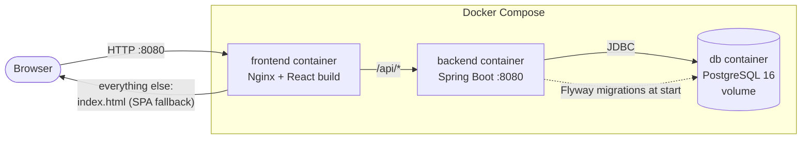
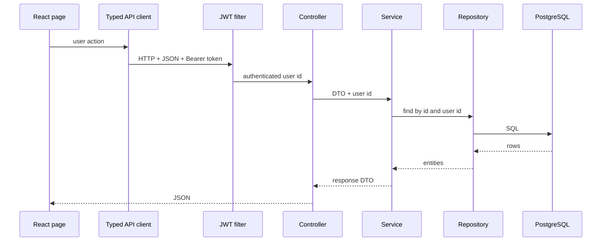
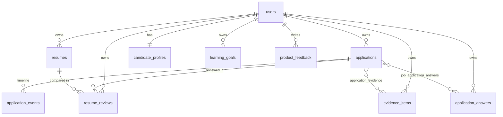
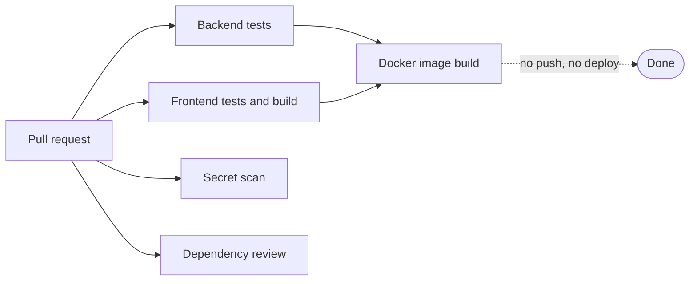

# Architecture

This page shows how KiwiHire Coach fits together. The diagrams are Mermaid, so
GitHub draws them.

## Runtime layout (Docker Compose)

Only the frontend container publishes a port. The backend and database are
reachable only inside the Compose network.

## Request flow

The user id always comes from the token, never from the request body, and every
lookup filters by it. That is what keeps one account's data away from another.

## Data model

Schema changes are Flyway migrations in
`backend/src/main/resources/db/migration`. Hibernate only validates the schema
(`ddl-auto=validate`); it never changes it.

## Where the rules live

The analysis is deterministic and runs in the browser, with no LLM call. The
rules are in `frontend/src/utils` and are described in
[`fit-rules.md`](fit-rules.md): eligibility and language gates, the weighted
fit score, follow-up and stale rules, text sanitising, interview preparation,
and the evidence check. `frontend/src/evals` holds fixed cases that fail the
build if a rule changes its answer.

## Build and delivery

Actions are pinned to commit SHAs and run with a read only token. Nothing
deploys automatically.

## Operations

- Health: `/actuator/health` (liveness and readiness probes enabled).
- Metrics: the Prometheus endpoint exists but is off unless
  `MANAGEMENT_ENDPOINTS=health,prometheus` is set. Enable it only where the
  backend port is not reachable from the internet.
- API documentation: Swagger UI at `/swagger-ui.html` and the OpenAPI JSON at
  `/v3/api-docs`. Both are off under the `prod` profile.
